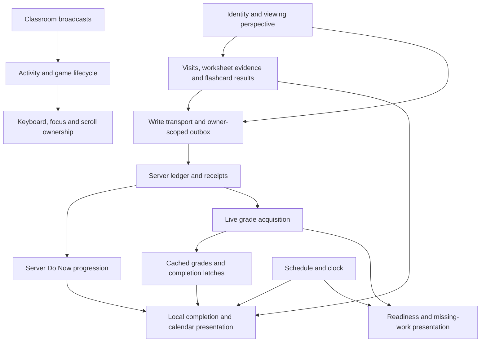

# Roadmap app state machine inventory

Current review: [STATE_MACHINE_MAP.md](STATE_MACHINE_MAP.md) records the 2026-11-08 source changes, current contracts and remaining risks. This earlier inventory is a discovery map, not a list of defects that all still exist.

Follow-up: [State machine history audit and recommended next actions](STATE_MACHINE_HISTORY_AUDIT.md) adds repository-wide investigation, controlled reproductions and historical intent. Read its corrections and WIP distinctions before acting on this earlier static inventory.

The app rooted at `ap_stats_roadmap_square_mode.html` contains many cooperating state machines. Most are encoded in combinations of globals, localStorage records, DOM visibility, pending promises, request generations, and timers. Some already have named phases; others are projections of time and evidence rather than stored workflow state.

The most consequential distinction is that **visited, locally completed, queued, server acknowledged, signature verified, graded, and ready are separate states**. A single `done` or `saved` flag cannot represent the behavior already implemented.

This inventory covers the current roadmap source, its direct scripts, the immediate classroom/park/calculator branches, the teacher workspace shell, server Do Now projection, and a representative worksheet completion publisher. It is a static inventory of those paths, not an exhaustive audit of every standalone worksheet, external quiz/driller application, server route, native Nearby implementation, or park physics engine. Source anchors refer to the working tree inspected on 2026-11-07. No application source was changed and no runtime tests were run.

An arrow below describes a transition caused by an event, response, user action, timer, or changed evidence. Labels such as “loading” are descriptive unless the entry names an actual state field. Numeric scores, BKT probabilities, coordinates, and timestamps are data carried by machines, not separate finite states. Pure formatting helpers are excluded. Repeated open/close and loading/error patterns are grouped where they share a lifecycle.

**How the major machines interact**

**Important interpretation corrections**

- Sequential lesson locking is bypassed: `_isLessonUnlocked()` returns `true` at [ap_stats_roadmap_square_mode.html:6626](ap_stats_roadmap_square_mode.html#L6626). Completion is still meaningful, but the retained prerequisite-dialog and unlock machinery does not establish an active sequential gate.
- Guest admission is retired even though guest aliases, pass/reconciliation helpers and flags remain. Expired roster identity, however, intentionally remains available for attributing local work.
- The normal graded flashcard entry uses the full timed deck. The older quick-check engine remains in source with different retry, persistence and completion semantics.
- Video is currently a visitation signal, not verified viewing completion. Do not infer an active video Done timer from older comments.
- The Study Break match uses the shared presence websocket; its retained RTC setup is disabled at match start. The current win target is one, despite older best-of-three comments.
- `cycleYear()` is a no-op at [ap_stats_roadmap_square_mode.html:11120](ap_stats_roadmap_square_mode.html#L11120). Calendar period and viewport navigation remain active.
- `openNightlyReview()` now opens the teacher workspace's recent view at [ap_stats_roadmap_square_mode.html:20503](ap_stats_roadmap_square_mode.html#L20503). Retained inline review painters and mutations are described separately below; their presence is not proof of a current normal UI entry.

**Additional roadmap and support machines**

These complement the learning, identity/sync, and classroom inventories below.

| Machine | States, triggers and representation | Source anchors |
| --- | --- | --- |
| Missing-work deadline projection | Not yet due → late but outside warning window → due soon → zero deadline reached/past. Any recorded work removes the corresponding missing track. Worksheet, quiz and non-bonus Blooket are separate tracks. Quarter-frozen `neverZero` work can become late without entering the zero-warning path. This is derived from evidence, due dates and clock, not a mutable enum. | [js/desk-missing-work.js:6](js/desk-missing-work.js#L6), `:41`, `:57`; roadmap `_zeroCurrentWarnings():16297`, `_pastDueCurrentWork():16316` |
| Snapshot data acquisition | No section/no credentials → unavailable to fetch; absent/stale cache → one in-flight request → fresh data or failure retaining prior data. Five-minute freshness and section identity determine cache reuse. Fields: `_snapState.section/data/fetchedAt/inflight/error`. | [ap_stats_roadmap_square_mode.html:16525](ap_stats_roadmap_square_mode.html#L16525), `:16548` |
| Snapshot presentation and selection | Student work ↔ graphs; teacher class ↔ assignments. Selected section/student, plot mode, focused assignment, previous/next and all-versus-one are independent regions. `_snapApp` stores these; role changes normalize valid view names. | [ap_stats_roadmap_square_mode.html:16622](ap_stats_roadmap_square_mode.html#L16622), `:16644`, `:16679`, `:17050` |
| Curriculum-dependent graph availability | Dot plot initially available; taught lesson dates add stem/histogram/box choices and select defaults. Date/period/lesson evidence recomputes availability; an unavailable selected mode is replaced. This is a derived capability state. | [lib/class-snapshot.js:93](lib/class-snapshot.js#L93); [ap_stats_roadmap_square_mode.html:16587](ap_stats_roadmap_square_mode.html#L16587) |
| Gradebook viewer | Closed → loading class or opening own cached gradebook → populated/empty/error. Quarter, section, and selected student determine `_activeGradebook`; close removes keyboard ownership. Own and class entry helpers remain defined; normal navigation may use the teacher workspace instead. | [js/desk-gradebook-grid.js:1](js/desk-gradebook-grid.js#L1), `:32`, `:53`, `:75`, `:169`, `:245` |
| Progress viewer | No remembered username → selection/login → lookup → source-specific availability. Tabs select driller/quiz/badges/time, each with cached/loading/empty/populated data. Close hides; destroy also clears cache. This is a separate identity selection from roster sign-in. | [js/desk-progress-app.js:8](js/desk-progress-app.js#L8), `:16`, `:35`, `:40`, `:88` |
| Teacher grade check-in | Explicit derived statuses `none/upcoming/due-soon/due/overdue/snoozed/reviewed`; time advances deadlines, review marks one period complete, snooze suppresses all open incomplete periods through a chosen date. Stored maps are `completed` and `snoozedUntil`. Minute ticks repaint without reloading. | [ap_stats_roadmap_square_mode.html:19992](ap_stats_roadmap_square_mode.html#L19992), `:20228`, `:20241`, `:23531` |
| Teacher inbox polling | Eligible/visible → requesting → available count or unavailable with last count retained. 401/503 halt polling until sign-in/role refresh or explicit inbox open. Hidden tabs skip polls; request generation rejects old responses; storage changes refresh the read marker. | `_teacherInboxState` at [ap_stats_roadmap_square_mode.html:20373](ap_stats_roadmap_square_mode.html#L20373); `:20443`, `:20459`, `:20482`, `:20489` |
| Teacher workspace and student detail lifecycle | Outer iframe absent → mounted → destroyed with focus restoration. Inside, explicit `idle/loading/ready/failed` combines with five workspace views. Student open/close changes `studentRequest`; evidence responses from an old student are discarded. Evidence fetch has loading/ready/error/retry; close destroys charts and account content. | [ap_stats_roadmap_square_mode.html:19658](ap_stats_roadmap_square_mode.html#L19658), `:19674`; [teacher-workspace.js:6](teacher-workspace.js#L6), `:55`, `:224`, `:272`, `:361`, `:379`, `:544` |
| Retained inline review workflow | Loading queue → student/item lens → idle → marking → success/conflict/failure → queue refresh. `_reviewBusy` serializes mutations; `_reviewPins` hold response hash and score so revised work returns 409 instead of accepting a stale review. AI draft buttons add fetching full answer → drafting → editable prefill/failure. Normal entry currently redirects to workspace. | [ap_stats_roadmap_square_mode.html:20307](ap_stats_roadmap_square_mode.html#L20307), `:20503`, `:20511`, `:20677`, `:20758` |
| Class Log authentication and loading | Teacher fold opens → separate Class Log credential entry if no token → signing in → loading summary → present/empty/unavailable. 401/403 clears this separate token and returns to sign-in. Pending/successful summary promises are cached; failed requests are evicted so another open retries. | [js/desk-class-log.js:61](js/desk-class-log.js#L61), `:87`, `:110`, `:129`; [lib/class-log-summary.js:89](lib/class-log-summary.js#L89), `:110` |
| Calendar period and viewport | Period B ↔ E updates URL, calendar/progress and asynchronous schedule overlay. Automatic anchor, explicit Today and manually paged window are distinct navigation states; viewport size changes the rendered window. Year cycling is inert. | [js/desk-calendar.js:2](js/desk-calendar.js#L2), `:124`, `:130`, `:135`, `:220`; [ap_stats_roadmap_square_mode.html:23400](ap_stats_roadmap_square_mode.html#L23400) |
| Main window, menu and mascot animation | Main window shown ↔ minimized; drag uses `isDrag/isPositioned`. Menu closed ↔ one menu open, with mouse-enter switching while open. Mascot walks → click-triggered jump → walking; tab visibility pauses animation. These are independent UI machines. | [ap_stats_roadmap_square_mode.html:11126](ap_stats_roadmap_square_mode.html#L11126), `:11280`, `:11320`, `:11419`, `:11431` |
| Bulletin and update notification | Bulletin loads once, then date/role filters derive hidden/upcoming/soon notices and badge. Build check runs initially, periodically and on visibility; new build → shown banner → dismissed or reload. `nudged` stays true after dismiss, suppressing another prompt for this page lifetime. | [ap_stats_roadmap_square_mode.html:19707](ap_stats_roadmap_square_mode.html#L19707), `:19719`, `:19831`, `:23502` |
| Offline video manifest and overlay | Unresolved manifest → ready with mappings or ready without mappings, including failed/not-offline cases. A mapped URL opens a local video overlay; close/Escape/backdrop pauses and removes it. No manifest hit leaves normal resource navigation available. | [offline-video.js:17](offline-video.js#L17), `:19`, `:29`, `:37`, `:61` |
| Service worker lifecycle and cache population | Browser install → best-effort core precache → activate/purge prior build caches/claim clients. Navigation tries network then cached page/shell; static asset cache miss fetches and populates. Background sync sends a drain request to pages because pages own auth. Cache policy is a decision function, not an extra stored FSM. | [sw.js:33](sw.js#L33), `:45`, `:53`, `:61`, `:103` |
| Network probe scheduling and connection | Calendar render schedules idle wait; busy activity defers bounded times; eligible attempt starts once per page, checks server enablement, stamps device/day, measures HTTP and RTC, posts result. RTC offer/answer/gather/channel/ping phases can time out independently. Fields include `started`, `idleTimer`, `busyChecks`, `lastSkip`, `lastRecord`. | [lib/net-probe.js:148](lib/net-probe.js#L148), `:218`, `:267`, `:290`, `:356`, `:399`, `:440`, `:478`, `:495` |
| Audio activation and preferences | No user activation → eligible to lazily create context → available/suspended/resumed, or permanently unavailable for that instance. Independent normal/quiet/off, channel mute, and auto/on/off low-power preferences gate playback. | [lib/sfx.js:64](lib/sfx.js#L64), `:94`, `:116`, `:268`, `:285`, `:594` |
| Audio sample and voice lifecycle | Sample absent → fetching → waiting for audio/decode → ready or failed; pending plays older than 500ms are discarded at decode completion. Voices are started, tracked and stopped/retired under the engine's voice limit. | [lib/sfx.js:486](lib/sfx.js#L486), `:544`, `:558`, `:585` |

**Where an explicit transition model would help most**

1. Give identity changes one coordinator. Sign-in, name-finder sign-in and signup currently repeat reset, migration, persistence, presence and rendering effects. Keep expiry, effective role, preview and view-as as separate dimensions.
2. Model grade evidence and delivery separately. Cached numbers can coexist with `unavailable`; local completion can coexist with a pending outbox row; a valid receipt can still be absent from the live gradebook.
3. Model flashcards as session state plus per-card state plus commit state. The active timed and retained quick engines share DOM and teardown but differ in resume and completion semantics.
4. Make callback validity an explicit part of lifecycle ownership. The app currently uses several valid but different techniques: request generations, object identity, room IDs, revisions, identity checks and connected-DOM checks.
5. Keep gameplay, overlay lifetime, focus, keyboard routing and scroll ownership separate. A minimized game can still run; a broadcast can preempt a scene; closing a window need not cancel room-scoped settlement.

The following inventories retain the detailed transition evidence for these recommendations.

## Learning and progress state-machine inventory

Read-only source audit centered on `ap_stats_roadmap_square_mode.html` (abbreviated **roadmap** below), with branches into the calendar, server Do Now, flashcard SRS/store, and a representative worksheet. No source edits or tests were run. State names below are analytical descriptions unless quoted as literal values. Derived states and partly explicit machines are identified separately from dormant machinery.

### Active machines and stateful projections

| # | Machine | States and transitions | Fields and source anchors |
|---|---|---|---|
| 1 | Resource visit and completion | Unvisited → visited; incomplete/waiting → eligible → completed. Instrumented worksheet eligibility is ≥60% local fill or recorded correctness, or all reflections E. Quiz eligibility is recorded credit ≥40% of the entire quiz. Off-pattern worksheets use first visit plus a five-minute timer. Done click optimistically completes, then rolls back on local-save failure. | Marks `{visitedAt, ts, score}` under `apstats_desk_marks_<identity>`. Roadmap [recordLinkVisit:6894](ap_stats_roadmap_square_mode.html#L6894), [recordProgress:6920](ap_stats_roadmap_square_mode.html#L6920), nested [_doneBtn:12345](ap_stats_roadmap_square_mode.html#L12345), [_studentMarkSave:12836](ap_stats_roadmap_square_mode.html#L12836). |
| 2 | Lesson completion and next-up | No progress → partial → done; ordered search selects earliest incomplete. A lesson with both artifacts requires worksheet-done AND Blooket-done; missing artifacts are vacuously satisfied. Grouped topics require all members. Derived rather than stored as one enum. | Roadmap [_isLessonComplete:6529](ap_stats_roadmap_square_mode.html#L6529); local marks, `_gradeLessonsCache`, server latches. [localLessonState:5277](ap_stats_roadmap_square_mode.html#L5277), [calNextUpTopic:5318](ap_stats_roadmap_square_mode.html#L5318), [paintLocalDoneCells:8379](ap_stats_roadmap_square_mode.html#L8379). |
| 3 | Durable server-completion latch | Per artifact not-confirmed → confirmed. Monotonic: successful live grades only add worksheet/Blooket flags; later lower or missing evidence never clears them. Wrong origin/version is ignored. | `apstats_server_complete_v1:<studentId>`, roadmap [_latchServerComplete:8730](ap_stats_roadmap_square_mode.html#L8730), [_serverCompleteFor:8757](ap_stats_roadmap_square_mode.html#L8757). Cached/offline-derived responses do not write latches; view-as disables them. |
| 4 | Server activity and lesson progression | Each manifest activity is `none`, `partial`, or `done`, based on ledger item-row presence, not score. All activities roll up to lesson state. Earliest incomplete activity becomes nextTask; work beyond gaps sets earlierGapFlag. | [roster-server/donow.js:30](roster-server/donow.js#L30) `buildDoneSet`, :46 `activityStats`, :56 `rollupLessonState`, :71 `computeDonow`, :175 first incomplete. |
| 5 | Calendar completion overlays | Server projection is unstarted/partial/done/ahead; ahead means done with a future date. Local projection is partial/done, with next-up separate. These coexist as CSS classes rather than mutually exclusive states. | Roadmap [donowCellState:8203](ap_stats_roadmap_square_mode.html#L8203), [paintDonowCells:8231](ap_stats_roadmap_square_mode.html#L8231), [paintLocalDoneCells:8379](ap_stats_roadmap_square_mode.html#L8379). Classes `dc-partial`, `dc-done`, `dc-ahead`, `dc-localpartial`, `dc-localdone`, `cal-current`. |
| 6 | Do Now card | Sign-in/password-required/unavailable → actionable todo or caught-up done. Successful `/donow` hydrates marks and launches grade fetch. Break, PC, poster, and work days override normal task presentation. Local completion replaces stale server nextTask; active summer track can override server order. | Roadmap [renderDoNow:10050](ap_stats_roadmap_square_mode.html#L10050); `_donowData`, `_calNextUp`, DOM classes `donow-signin/todo/done`. Visibility refresh:10262. The signin visual class also represents network failure. |
| 7 | Earlier-work speed bump | Unacknowledged → shown → acknowledged for session. Continue opens requested lesson; go-to scrolls Do Now. Close alone hides without acknowledging. Local completion suppresses stale server gap warning. | Roadmap [_bumpAcked:8431](ap_stats_roadmap_square_mode.html#L8431), [maybeBumpThenOpen:8438](ap_stats_roadmap_square_mode.html#L8438). Nonblocking. |
| 8 | Grade acquisition and recovery | `unknown → loading → available` or `unavailable`; failures classify auth/server/network. Unavailable can still carry offline-derived or cached numbers. Live recovery updates dependent projections. First cold→warm and unavailable→available force full calendar reconciliation. Identity switch resets caches/retry. | Roadmap [_gradeLoadState:8531](ap_stats_roadmap_square_mode.html#L8531), `_gradeLoadError`, `_gradeLastRenderedState`; [_resetGradeStateForIdentitySwitch:8556](ap_stats_roadmap_square_mode.html#L8556), [renderDoNowGrades:9251](ap_stats_roadmap_square_mode.html#L9251), fallback:9325, recovery:9384. Explicit state field with lifecycle scattered across globals/renderers. |
| 9 | Grade retry scheduler | Idle → scheduled (15/30/60 seconds) → retrying; exhausted after three scheduling attempts. Success or identity reset cancels timer and resets counter. | Roadmap `_gradeRetryCount`, `_gradeRetryTimer`, `GRADE_RETRY_BACKOFF_MS`, [_scheduleGradeRetry:9077](ap_stats_roadmap_square_mode.html#L9077). Caller:9333 schedules after all unavailable failures, including auth, although comments mention server/network. |
| 10 | Grade evidence source and confidence | No evidence → live evidence. On failure, derive from local ledger plus offline inputs, else use cached `/grade`, else show unknown. Cached/derived data never promotes load state to available. Origin and identity gate acceptance. | Roadmap [_gradeCacheKey:8667](ap_stats_roadmap_square_mode.html#L8667), [_loadGradeCache:8693](ap_stats_roadmap_square_mode.html#L8693), [_phase2ReDeriveGrade:8963](ap_stats_roadmap_square_mode.html#L8963), fallback:9332. [js/desk-calendar.js:609](js/desk-calendar.js#L609) shows loading/unavailable instead of false zero progress. |
| 11 | Calendar focus and navigation | Automatic next-up/today anchor ↔ manually paged window. Today selects explicit today anchor for page lifetime. Summer schedule participates before school start. First grade warm-up/recovery can resize/reanchor view. | [js/desk-calendar.js:124](js/desk-calendar.js#L124) `_calPageOffset`, `_calStepWeeks`, `_calOnToday`; :130 `calStep`, :135 `calToday`, :220 `rCal`, :338 anchoring. Period/year are orthogonal selections. |
| 12 | Timed flashcard session | Idle → fetching → answering → feedback delay (800 ms) → next answering → recap/committing → outcome → closed. Fetch errors show dialog. Close cancels countdown and delayed advance. Current graded mode uses full deck, 40 seconds per card. | Roadmap [_ftState:15335](ap_stats_roadmap_square_mode.html#L15335), [_ftStart:15434](ap_stats_roadmap_square_mode.html#L15434), [_ftRenderCard:15464](ap_stats_roadmap_square_mode.html#L15464), [_ftHandle:15540](ap_stats_roadmap_square_mode.html#L15540), [_ftFinish:15598](ap_stats_roadmap_square_mode.html#L15598), [_bfCloseUI:15211](ap_stats_roadmap_square_mode.html#L15211). Fields topic, btn, round, answered, timerId, advanceId, remaining, cardStartMs, roundId, perm. Phase is inferred from flags/timers/DOM. |
| 13 | Timed card lifecycle | Unresolved with 0 misses → unresolved with 1 → unresolved with 2 → struck out at 3 (zero credit). Correct resolves with 1, ⅔, or ⅓ credit according to prior misses. Wrong/timeout requeues unless third miss. Empty unresolved queue completes round. | Roadmap [_ftCreateRound:15342](ap_stats_roadmap_square_mode.html#L15342), [_ftRecordOutcome:15356](ap_stats_roadmap_square_mode.html#L15356). Per-card `{misses,resolved,earned}`, `round.order`, deck, log, total. Nested in session machine. |
| 14 | Flashcard best-score commit | Finished run → refresh grade floor → new-best save or preserve prior best → optimistic cache patch → second refresh → saved/kept/error/read-only outcome. | Roadmap [_blooketCommit:15727](ap_stats_roadmap_square_mode.html#L15727) compares synced Blooket score and local mark.score; [_blooketPatchGradeCache:15778](ap_stats_roadmap_square_mode.html#L15778); [_ftRenderOutcome:15618](ap_stats_roadmap_square_mode.html#L15618). |
| 15 | Review session | Idle/loading → `answer → rate → saving → answer`; ends `finished` at empty queue or 20 ratings. Correct offers good/easy; wrong/unsure offers again/hard. Again reinserts card after up to three others. Read-only blocks writes. | Roadmap [_rvState:13054](ap_stats_roadmap_square_mode.html#L13054); start:14198, mixed start:14313, render:14461, answer:14521, rate:14564, finish:14644. Fields topic, btn, csv, mixed, queue, idx, ratings, roundId, round, seq, cardStart, current, stage, store, folded, deckCardsByCsv. Partly explicit via stage. |
| 16 | Per-card spaced-repetition schedule | New/due → scheduled; time passage makes scheduled due. Again lapses to due today, reps=0. Hard/good/easy advance due date and repetitions. Learned is derived from reps≥2 and not currently due. Logs fold with deduplication. | [lib/flashcard-srs.js:101](lib/flashcard-srs.js#L101) newCard, :149 applyGrade, :276 foldLog, :316 dueCards, :352 summarize. Fields ease, intervalDays, dueDay, reps, lapses, lastGrade, lastTs. |
| 17 | Flashcard readiness projection | Not yet → Getting there → Ready; can regress after latest first-attempt failure. Ready needs ≥3 objective corrects, a correct at least one day after first evidence, and latestClean. Review ratings/retries do not count as objective evidence. | [lib/flashcard-srs.js:434](lib/flashcard-srs.js#L434) foldMastery, :463 mode filter, :530 readiness, :538 readinessLabel. Fields objectiveCorrects, spacedCorrect, latestClean, ready, n. BKT probability is continuous state, not a finite-state machine. UI is readinessBadge-gated. |
| 18 | Flashcard passport import | Idle → parsing/validation → preview confirmation → imported/rejected. Cancel/Escape/backdrop dismiss. Confirmation rechecks identity/view-as/read-only. Success invalidates folded/readiness/due caches. | Roadmap [_fcpImportFile:13504](ap_stats_roadmap_square_mode.html#L13504), confirmation:13596, identity guard:13618, import:13635, invalidation:13646. |
| 19 | Stored flashcard lifecycle | Active card ↔ tombstoned. Import accepts newer card over older tombstone; newer/equal tombstone removes older card; malformed imported card becomes tombstone. | [lib/flashcard-store.js:327](lib/flashcard-store.js#L327) tombstone, :456 mergeImportedCard, :487 mergeImportedTombstone. Timestamp arbitration uses removedAt versus lastTs. Reachable via passport import; no visible delete workflow found in this HTML. |
| 20 | Grade coach panel and chat | Unbuilt/closed → built/open ↔ closed. Chat idle → requesting → answered/unavailable → enabled. Open conversation survives grade refresh. Detached reply nodes ignore late responses. | Roadmap [renderWhySoLow:9590](ap_stats_roadmap_square_mode.html#L9590), closure [built:9617](ap_stats_roadmap_square_mode.html#L9617), [_coachAsk:10004](ap_stats_roadmap_square_mode.html#L10004). State includes askBtn.disabled, history, DOM visibility/connectivity. |
| 21 | Video availability and visitation | Date/override-derived AP-unavailable/AP-available. Bundled offline copy takes precedence when present. Online link unvisited → visited only. | Roadmap [_isApClassroomAvailable:6648](ap_stats_roadmap_square_mode.html#L6648), resource selection:12474, visited-only behavior:12446, visit writer:6894. No current video completion verification. |
| 22 | Worksheet completion publisher | Empty → partially filled → eligible; can regress as answers are cleared. Tracker eligibility is ≥80% attempted or all-E reflections; desk intentionally applies its own 60% threshold to pct. Input/change/AI updates publish identity-scoped storage. | Representative [u1_lesson2_live.html:1893](u1_lesson2_live.html#L1893) `_wsStudentKey`, :1914 `updateWorksheetCompletion`; injection template [scripts/wire-completion-tracker.mjs:91](scripts/wire-completion-tracker.mjs#L91). Roadmap storage listener:12816 refreshes open panel across tabs. |

### Dormant and legacy machinery

- **Sequential lesson locking is disabled.** Roadmap [_isLessonUnlocked:6626](ap_stats_roadmap_square_mode.html#L6626) returns `true`. Teacher unlock cache/overrides and `_showLessonLockedDialog` remain, but this predicate supplies no active prerequisite gate. Surrounding comments describing locking are historical.
- **Quick-check flashcard engine remains but is not the normal entry path.** Roadmap [_bfStartQuick:14747](ap_stats_roadmap_square_mode.html#L14747) through finish logic:15204 implements saved shuffled-deck resume, unanswered→answered→next, early pass at 80%, failed→retry (optional redraw), passed→delayed commit. [_bfState:13032](ap_stats_roadmap_square_mode.html#L13032) contains topic, btn, deck, idx, score, answered, finishId, advanceId, finished, roundId, seq, cardStart, misses, perm, primedQnums, poolQnums, seenQnums, allCards, lastFinishAt. [_bfFinish:15014](ap_stats_roadmap_square_mode.html#L15014); close/resume:15276. Normal [openBlooketFlashcards:14138](ap_stats_roadmap_square_mode.html#L14138) routes to `_ftStart`; comment:14133 explicitly marks quick mode unreachable from normal UI. Resume persistence belongs to quick mode, not active timed mode.
- **Quick retry cooldown is disabled:** `BLOOKET_RETRY_COOLDOWN_MS = 0`, roadmap:12960.
- Flashcard feature configuration has a small load-once lifecycle via `_fcFlagsPromise`, roadmap [_fcLoadFlags:12971](ap_stats_roadmap_square_mode.html#L12971). It gates due/review sync/permutation behavior; individual flags are configuration, not separately counted machines.

### Coupling and inconsistent predicates

1. **Done has several meanings.** Server Do Now counts ledger-row presence; worksheet eligibility counts attempts; grades count correctness; lesson completion combines timestamps, scores, and durable latches. Local-versus-server next-task reconciliation at roadmap:10192 exists because these predicates differ.
2. **Blooket completion is broader than the 80% comments.** [_blooketCommit:15754](ap_stats_roadmap_square_mode.html#L15754) saves any improved score; `_studentMarkSave` writes local `ts`; [_isLessonComplete:6561](ap_stats_roadmap_square_mode.html#L6561) accepts any Blooket timestamp OR ≥80 synced score OR latch. An improved score below 80 can therefore satisfy local Blooket completion. It would be inaccurate to describe the current tint predicate as solely ≥80.
3. **Unavailable grades and visible grade numbers can coexist intentionally.** Cached/derived rendering at roadmap:9330 does not imply live connectivity.
4. **Completion coordinates overlapping refreshes.** `_studentMarkSave` starts grade and Do Now requests; Do Now starts another grade request; `_blooketCommit` refreshes before and after commit. Shared caches coordinate the flow without one transaction owner.
5. **Completion latches cannot regress even when correctness does.** This is intentional resilience behavior, distinct from a live score projection.
6. **Timed and quick engines share modal DOM/teardown but differ in persistence and finish semantics.** Treating them as one lifecycle would lose important transitions.
7. **Tracker and desk eligibility thresholds differ intentionally.** Worksheet tracker publishes an 80% eligible flag; the desk reads pct and uses 60%, rather than trusting that eligible flag.

### Coverage boundary

Covered roadmap ranges 6529–6970, 8196–10265, 12266–15790 and the named supporting modules. Study-break game internals, wallet/snapshot after 15800, embedded apps later in the HTML, roster authentication and transport modules, and the external curriculum quiz application internals belong to other review branches. Ordinary score arithmetic and continuous BKT probability updates were not counted as finite-state machines.

## Implicit state machines: identity, sync, messaging, and wallet

Read-only source inventory rooted in `ap_stats_roadmap_square_mode.html`, reviewed 2026-11-07. All `HTML:<line>` anchors below refer to that file. States are descriptive reconstructions of existing behavior; they are not proposed enum values. A workflow may contain several independent state dimensions.

### Identity and access

| Machine | States and transitions | Existing state and source anchors |
|---|---|---|
| Session and access lifecycle | No session → signing in → persisted student/teacher session; error returns to credential entry. A session can remain present while expired; reauthentication renews it. Sign-out clears credentials and reloads. | [roster-client.js:60](roster-client.js#L60) (`current`), [roster-client.js:94](roster-client.js#L94) (`isExpired`), [roster-client.js:134](roster-client.js#L134) (`signIn`), [roster-client.js:339](roster-client.js#L339) (`refreshIfNeeded`); [HTML:6451](ap_stats_roadmap_square_mode.html#L6451), [HTML:7377](ap_stats_roadmap_square_mode.html#L7377), [HTML:8059](ap_stats_roadmap_square_mode.html#L8059), [HTML:23370](ap_stats_roadmap_square_mode.html#L23370). |
| Sign-in wall and optional account dialog | Closed ↔ optional sign-in dialog, or mandatory wall that cannot close until access is granted. Submission has pending/success/error substates. | `_signinWallActive`, `submitSignIn._pending`, overlay display, disabled OK button. [HTML:6511](ap_stats_roadmap_square_mode.html#L6511), [HTML:7274](ap_stats_roadmap_square_mode.html#L7274), [HTML:7352](ap_stats_roadmap_square_mode.html#L7352), [HTML:7361](ap_stats_roadmap_square_mode.html#L7361), [HTML:7377](ap_stats_roadmap_square_mode.html#L7377). |
| Name-finder navigation | Loading roster → dial; dial narrows alphabetical ranges; leaf → password; back restores range; not-found → signup/manual sign-in; empty/offline roster → manual sign-in. | Already partly explicit: `_nfState = 'dial'\|'password'\|'notfound'`, plus `_nfStack`, `_nfLo/_nfHi`, `_nfPicked`, `_nfSubmitPassword._pending`. [HTML:7498](ap_stats_roadmap_square_mode.html#L7498), [HTML:7540](ap_stats_roadmap_square_mode.html#L7540), [HTML:7643](ap_stats_roadmap_square_mode.html#L7643), [HTML:7683](ap_stats_roadmap_square_mode.html#L7683), [HTML:7766](ap_stats_roadmap_square_mode.html#L7766). |
| Signup | Candidate generated → form editing → claiming → signed in; username conflict rerolls candidate and returns to editing; failure permits retry. | `_signupCandidate`, `_signupSectionValue`, `submitSignUp._pending`, DOM. [HTML:7828](ap_stats_roadmap_square_mode.html#L7828), [HTML:7837](ap_stats_roadmap_square_mode.html#L7837), [HTML:7883](ap_stats_roadmap_square_mode.html#L7883), [HTML:7948](ap_stats_roadmap_square_mode.html#L7948), [HTML:8008](ap_stats_roadmap_square_mode.html#L8008). |
| Required or voluntary password change | Signed in with temporary password → forced change dialog → saving → ordinary session. Voluntary dialog allows cancel; forced flow exits through sign-out. | Session `mustChangePassword`, `voluntary` argument, submit pending flag, modal DOM. [HTML:8079](ap_stats_roadmap_square_mode.html#L8079), [HTML:8124](ap_stats_roadmap_square_mode.html#L8124), [HTML:8135](ap_stats_roadmap_square_mode.html#L8135); [roster-client.js:181](roster-client.js#L181). |
| Teacher perspective | Teacher normal view ↔ student preview; teacher normal view → loading selected student → per-tab read-only view-as after reload → normal view on exit. Preview is a separate flag from view-as. | `apstats_preview_as_student`, `apstats_view_as_context`, `view-as-loading` CSS, `willReload`. [HTML:5336](ap_stats_roadmap_square_mode.html#L5336), [HTML:5390](ap_stats_roadmap_square_mode.html#L5390), [HTML:5401](ap_stats_roadmap_square_mode.html#L5401), [HTML:5565](ap_stats_roadmap_square_mode.html#L5565), [HTML:6396](ap_stats_roadmap_square_mode.html#L6396), [HTML:6420](ap_stats_roadmap_square_mode.html#L6420). |
| Teacher gate override | Modal closed → editable → posting grouped lesson members → saved and closing, or error/retry; previously saved members skipped. | Button disabled/status DOM and `apstats_view_as_lesson_unlocks` array. [HTML:5470](ap_stats_roadmap_square_mode.html#L5470), [HTML:5493](ap_stats_roadmap_square_mode.html#L5493). |

#### Reachability and identity distinctions

Guest entry is retired. `_deskAccessGranted()` ignores `apstats_guest_active`, and `_nfGuestSignIn()` redirects to signup ([HTML:6460](ap_stats_roadmap_square_mode.html#L6460), [HTML:7783](ap_stats_roadmap_square_mode.html#L7783)). `getGuestIdentity`, Guest Pass, old guest flags, and messaging aliases remain compatibility/reconciliation machinery. Guest is not a currently admitted Desk session merely because those helpers still exist.

Identity combines persisted session, expiry, server-verified role, cached role, mandatory password change, student preview, and view-as. `current()` intentionally returns an expired session. This preserves owner-attributed local work while transport waits for reauthentication.

The sign-in completion paths have broad effects: mirror the identity into the legacy key, remove guest activation, trigger flashcard pull and queue replay, update menus/role, reset grade caches, migrate marks, reconcile period, and refresh classroom/Do Now surfaces. Successful sign-in, name-finder sign-in, and signup reproduce these effects separately. [HTML:7708](ap_stats_roadmap_square_mode.html#L7708) explicitly documents that the name-finder success path mirrors `submitSignIn()` and is maintained by hand.

### Loading, storage, and transport

| Machine | States and transitions | Existing state and source anchors |
|---|---|---|
| Roadmap registry and overlay hydration | Built-in data → cached data → fetching/retrying → live data; failure keeps saved/built-in data and renders cached/offline/degraded status. Browser online event triggers refresh. Schedule and URL overlay refreshes can succeed independently. | `usedSavedRegistry`, `liveRegistryLoaded`, `_supaCache`, stored cache timestamps, `roadmap-status.dataset.net`. [HTML:4937](ap_stats_roadmap_square_mode.html#L4937), [HTML:5050](ap_stats_roadmap_square_mode.html#L5050), [HTML:5084](ap_stats_roadmap_square_mode.html#L5084). |
| Grade write transport | Validate → blocked by read-only/no identity, or direct POST → acknowledged receipt. Offline-pack writes go directly to outbox; network/auth failures may become queued; server rejection remains an error. Newer versions supersede old queued intent. | `transportSequence`, `_latestStartedSequence`, `_successfulSequence`, per-key `_sendChains`. [gradebook-client.js:231](gradebook-client.js#L231), [gradebook-client.js:288](gradebook-client.js#L288), [gradebook-client.js:353](gradebook-client.js#L353), [gradebook-client.js:422](gradebook-client.js#L422). |
| Durable outbox row | Enqueued → awaiting eligible owner/network → sending → deleted on successful matching version; failure leaves queued; newer edit replaces version; repeated server failures → parked. | `studentId`, sequence, `serverFailures`, `PARK_AFTER = 12`; IndexedDB with memory fallback. [offline-queue.js:42](offline-queue.js#L42), [offline-queue.js:235](offline-queue.js#L235), [offline-queue.js:253](offline-queue.js#L253), [offline-queue.js:271](offline-queue.js#L271), [offline-queue.js:288](offline-queue.js#L288); ownership gate at [gradebook-client.js:530](gradebook-client.js#L530). |
| Outbox drain scheduler | Idle → scheduled → draining → empty/idle or backed-off retry; reconnect during drain marks rerun. Rejected token suppresses retries until token changes/success; parked-only queues stop retrying. | `_offlineDrainTimer`, `_offlineDrainInFlight`, `_offlineDrainRerun`, `_offlineDrainBackoffMs`, `_lastAuthFailToken`. [gradebook-client.js:367](gradebook-client.js#L367), [gradebook-client.js:379](gradebook-client.js#L379). |
| Prior-answer recovery | Loading → available, or unavailable(auth/network/server) → retry scheduled → recovering. Auth failure waits for sign-in; other failures have three backoffs; manual retry resets retry budget. | Shared worksheet branch: `_priorFailed`, `_priorRetryTimer`, `_priorRetries`, `_priorRecovering`; unavailable `Map` carries `loadFailed/loadOutcome/httpStatus`. [gradebook-client.js:25](gradebook-client.js#L25), [gradebook-client.js:52](gradebook-client.js#L52), [gradebook-client.js:60](gradebook-client.js#L60), [gradebook-client.js:72](gradebook-client.js#L72), [gradebook-client.js:584](gradebook-client.js#L584). |
| Flashcard cloud reconciliation | Not ready → ready → pulling/merging → optional push → synchronized; debounced local edits → push; 409 → bounded GET/merge/PUT retry; hard failures → disabled; new identity resets state, new token re-enables auth-disabled client. Page-hide flushes pending push. | `identity`, `disabledReason`, `disabledToken`, `baseUpdatedAt`, `lastPullAt`, `pushTimer`, `inflight`. [lib/flashcard-sync.js:247](lib/flashcard-sync.js#L247), [lib/flashcard-sync.js:278](lib/flashcard-sync.js#L278), [lib/flashcard-sync.js:298](lib/flashcard-sync.js#L298), [lib/flashcard-sync.js:369](lib/flashcard-sync.js#L369), [lib/flashcard-sync.js:383](lib/flashcard-sync.js#L383), [lib/flashcard-sync.js:414](lib/flashcard-sync.js#L414), [lib/flashcard-sync.js:486](lib/flashcard-sync.js#L486), [lib/flashcard-sync.js:529](lib/flashcard-sync.js#L529). |
| Receipt trust classification | Stored/unverified receipt → verifying → verified or tampered; missing signatures remain unverified. Fresh verification annotates returned rows. | `row._verify.state`; derived classifications rather than a persisted workflow enum. [ledger-store.js:255](ledger-store.js#L255), especially [ledger-store.js:270](ledger-store.js#L270). |
| Peer gossip handshake | Initiator sends HELLO digest → responder sends SYNC(rows/request) → initiator verifies/stores and sends SEND → responder verifies/stores → done. Discovery creates per-peer sessions; lost peer removes session; the default 15-second round stops transport. Multi-lane variant isolates grades/submissions. | Explicit protocol message types but implicit session phase; promises, peer maps, counters. [ledger-gossip.js:177](ledger-gossip.js#L177), [ledger-gossip.js:194](ledger-gossip.js#L194), [ledger-gossip.js:200](ledger-gossip.js#L200), [ledger-gossip.js:258](ledger-gossip.js#L258), [ledger-gossip.js:312](ledger-gossip.js#L312). `nearby-transport.js` largely adapts native-plugin capability. |
| PWA install | Unavailable → browser offers install → prompt outstanding → accepted/dismissed; app-installed clears prompt. | `deferred` prompt presence is state. [pwa-register.js:13](pwa-register.js#L13), [pwa-register.js:21](pwa-register.js#L21), [pwa-register.js:35](pwa-register.js#L35). Service-worker message bridges background sync to queue drain at [pwa-register.js:68](pwa-register.js#L68). |

#### Transport invariants and coupling

- Saved locally, acknowledged by the server, signature verified, and present in the live gradebook are separate conditions. A single `saved` flag cannot represent the existing behavior.
- Outbox deletion compares the current stored sequence with the sent sequence. An older response must not delete a newer unsent edit ([offline-queue.js:305](offline-queue.js#L305)).
- Replay requires the queued row's owner to match the signed-in student. Other-owner and ownerless legacy records remain queued ([gradebook-client.js:534](gradebook-client.js#L534)).
- Parked rows remain retained and exportable; parking stops automatic sends after repeated server failures. Authentication/network failures do not all consume the same failure budget ([offline-queue.js:271](offline-queue.js#L271)).
- Flashcard synchronization binds stamps, debounce timers, disabled status, and response application to an identity. Hard failures include allowlist, auth, too-large, not-provisioned, unreadable-remote, and email-mismatch conditions.
- Gossip has explicit frame types, but does not maintain a formal session-phase variable. Its lifecycle is reconstructed from message handlers and the `done` promise.

### Messaging

| Machine | States and transitions | Existing state and source anchors |
|---|---|---|
| Nudge toast lifecycle | Incoming → active; duplicate ID ignored; overflow evicts oldest beyond four; reply → disabled/sending → removed; dismiss → removed. | `_activeNudges` map, per-toast DOM. [HTML:5686](ap_stats_roadmap_square_mode.html#L5686), [HTML:5699](ap_stats_roadmap_square_mode.html#L5699), [HTML:5760](ap_stats_roadmap_square_mode.html#L5760), [HTML:5767](ap_stats_roadmap_square_mode.html#L5767). |
| Inbox and read tracking | No unread ↔ unread; polling and WS hints add awareness; opening history marks seen; incoming while open reloads history. | Persisted `apstats_nudge_last_seen`, `_studentNudgeUnreadCount`, `_studentNudgeLatestTeacherAt`, `_seenNudgeNotifyIds`; poll single-flight flag/timer. [HTML:5824](ap_stats_roadmap_square_mode.html#L5824), [HTML:5958](ap_stats_roadmap_square_mode.html#L5958), [HTML:5986](ap_stats_roadmap_square_mode.html#L5986), [HTML:6022](ap_stats_roadmap_square_mode.html#L6022), [HTML:6047](ap_stats_roadmap_square_mode.html#L6047). |
| DM/history request lifecycle | Closed → open/loading → populated/empty/error. Latest history request wins. Composer idle → sending → sent/cleared or error/retry. Teacher send success notifies peers then closes dialog. | `_sdmHistoryEpoch`, modal visibility, status CSS/text, button disabled. [HTML:6082](ap_stats_roadmap_square_mode.html#L6082), [HTML:6084](ap_stats_roadmap_square_mode.html#L6084), [HTML:6148](ap_stats_roadmap_square_mode.html#L6148), [HTML:6301](ap_stats_roadmap_square_mode.html#L6301). |

Live notification, durable history, unread tracking, and toast display are separate concurrent machines. Nudge-toast reply transport is best effort: the toast is removed after attempted WS delivery and HTTP logging, without requiring an HTTP success result ([HTML:5767](ap_stats_roadmap_square_mode.html#L5767)). That differs from DM and teacher-send forms, which inspect response success before displaying success.

### Wallet, social actions, and sensitive UI lifecycle

| Machine | States and transitions | Existing state and source anchors |
|---|---|---|
| Wallet data/view lifecycle | Closed → immediate local receipt paint/loading → merged durable+bonus receipts → verified-summary repaint; close hides and clears ceremony. Receipt grouping switches tabs and expanded groups independently. | Overlay visibility, `loading`, `_walletReceiptFeedTab`, `_walletReceiptExpandedGroups`. [HTML:17466](ap_stats_roadmap_square_mode.html#L17466), [HTML:17681](ap_stats_roadmap_square_mode.html#L17681), [HTML:19562](ap_stats_roadmap_square_mode.html#L19562), [HTML:19585](ap_stats_roadmap_square_mode.html#L19585), [HTML:19604](ap_stats_roadmap_square_mode.html#L19604). |
| Wallet action form | No form ↔ buy/cash-out/gift form; exactly one form open; submitting → refresh wallet on success or error/retry. Eligibility depends on balances and matured/unsent DOGE. Details expansion starts chain-status polling. | Local `openPill`, DOM button disabled, `sellableDoge`, `dogeBalance`, `dogeSent`; timer guarded by visible/connected DOM. [HTML:17866](ap_stats_roadmap_square_mode.html#L17866), [HTML:18298](ap_stats_roadmap_square_mode.html#L18298), [HTML:18356](ap_stats_roadmap_square_mode.html#L18356), [HTML:18449](ap_stats_roadmap_square_mode.html#L18449). |
| Candy poke | Eligible → balance checking → three-second undo window → posting/cooldown → sent; undo cancels timer; failed send releases cooldown; after ten minutes eligible again. | Per-recipient `_candyPokePending` and `_candyPokeCooldown`; inbound `_candySeenGiftIds` dedupe. [HTML:17901](ap_stats_roadmap_square_mode.html#L17901), [HTML:17977](ap_stats_roadmap_square_mode.html#L17977), [HTML:18007](ap_stats_roadmap_square_mode.html#L18007), [HTML:18027](ap_stats_roadmap_square_mode.html#L18027). |
| Avatar popover | Closed → name chip → action menu; new target resets to chip; action/outside click/Escape closes. | Already partly explicit `_avatarMenu.stage = null\|'name'\|'menu'`, `el`, `username`, `_handlingClick`. [HTML:18053](ap_stats_roadmap_square_mode.html#L18053), [HTML:18062](ap_stats_roadmap_square_mode.html#L18062), [HTML:18241](ap_stats_roadmap_square_mode.html#L18241). |
| Student wallet provisioning/onboarding | Ineligible/disabled → eligible opt-in → proposed-address awaiting approval; rejection allows another attempt; assigned address stops onboarding. | Server fields `studentWalletOnboardingEligible`, `studentWalletOptInEnabled`, `proposedAddressMasked`, `proposalRejectionReason`, `dogeAddress`. [HTML:18653](ap_stats_roadmap_square_mode.html#L18653), [HTML:18672](ap_stats_roadmap_square_mode.html#L18672). Server approval transitions themselves were not traced in this slice. |
| Wallet creation ceremony | Warning/typed acknowledgement → generating → reveal recovery words → quiz → proposing address → pending approval; failed quiz returns to the same words; propose failure permits retry; cancel/close/pagehide destroys secrets. Async generation arriving after disposal is destroyed. | No phase enum: nested render functions, `active`, `session`, `words`, DOM, global cleanup callback. [HTML:18721](ap_stats_roadmap_square_mode.html#L18721), [HTML:18740](ap_stats_roadmap_square_mode.html#L18740), [HTML:18766](ap_stats_roadmap_square_mode.html#L18766), [HTML:18786](ap_stats_roadmap_square_mode.html#L18786), [HTML:18827](ap_stats_roadmap_square_mode.html#L18827). [js/student-wallet.js:1036](js/student-wallet.js#L1036) also has live/destroyed secret-session state. |
| Student wallet print | Confirmation dialog → preparing request/temporary popup → printing → sheet remains open → disposed. Failure returns to confirm/retry; session change, pagehide, popup close, Done/Escape trigger cleanup. | `disposed`, `busy`, `sheetOpen`, `session`, `controller`, timeout, 250ms identity timer. [js/student-wallet-print.js:56](js/student-wallet-print.js#L56), [js/student-wallet-print.js:100](js/student-wallet-print.js#L100), [js/student-wallet-print.js:112](js/student-wallet-print.js#L112), [js/student-wallet-print.js:137](js/student-wallet-print.js#L137), [js/student-wallet-print.js:223](js/student-wallet-print.js#L223). |
| Receipt verification UI | Idle → checking signature → failed signature or verified → checking live gradebook → present/absent/unavailable; button re-enabled at terminal outcome. | Button disabled and status DOM; two independent checks. [HTML:19438](ap_stats_roadmap_square_mode.html#L19438). |

The wallet ceremony and print lifecycle are especially clear candidates for explicit state modeling: both encode legal steps and cleanup obligations through closures, booleans, DOM replacement, pending promises, and callbacks. Their external provisioning fields should remain distinct from the transient UI ceremony state.

### Evidence and boundaries

This slice does not claim to cover deeper wallet/roster server implementations, `sw.js`, `offline-video.js`, `lib/net-probe.js`, or the native Nearby implementation. Those boundaries were reported to the coordinating review. Prior-answer recovery is a shared worksheet branch of the loaded gradebook client; native gossip and PWA transitions are capability-dependent. Partly explicit name-finder and avatar-menu states are included to show their coupling to surrounding implicit machines.

## Implicit state machines: classroom, games, and UI

Read-only source inventory rooted in `ap_stats_roadmap_square_mode.html`, November 7, 2026. The tables describe conceptual states reconstructed from fields, DOM properties, timers, and events. They are not counts of every possible finite state. Named state variables and explicit reducers are identified separately where present.

### Roadmap and desktop UI

| Machine | Fields and transitions | Source anchors |
|---|---|---|
| App window lifetime | `iframe.src`, overlay display, `.maximized`: unloaded → opened/loaded → minimized with live iframe → restored. Destroy clears iframe and maximize state. Pop-out opens a separate browser window. | HTML [openApp:21404](ap_stats_roadmap_square_mode.html#L21404), [destroyApp:21434](ap_stats_roadmap_square_mode.html#L21434), [minimizeApp:21446](ap_stats_roadmap_square_mode.html#L21446), [toggleMaximize:21573](ap_stats_roadmap_square_mode.html#L21573) |
| Desktop interaction | Selected icon, `dragIcon`, `didDrag`: pointer down → potential click → drag → positioned/released. Separate window drag uses `dragWin`; focus stacking uses `_appTopZ`. | HTML:21586,21605,21689,21738 |
| Modal dismissal ownership | Visible overlays and computed z-index determine Escape ownership. Dedicated closers, self-handled modals, sign-in wall, and game follow distinct paths. State is distributed across DOM visibility and handlers. | HTML [_escCloseTopModal:22735](ap_stats_roadmap_square_mode.html#L22735), key handler:22784 |
| Activity renderer lifetime | `_activityHandle`, `_activityHandleType`, mount, and teardown timer: absent → mounted/live → final outcome → delayed destruction after 2.5 seconds. New live activity cancels old timer; activity-type change disposes prior renderer. | HTML [_handleActivityState:23033](ap_stats_roadmap_square_mode.html#L23033), outcome branch:23142 |
| Activity keyboard ownership | Up/down reaches an unfinished activity only for its participant. Study Break, park, and editing targets take precedence. | HTML:23185 |

### Presence and invitations

| Machine | Fields and transitions | Source anchors |
|---|---|---|
| Presence connection | `ws`, `connected`, `_autoPresence`, heartbeat/reconnect timers: no identity prevents connection; connecting → identified/live; close clears peers → reconnect after five seconds when auto mode is enabled. Heartbeat runs every 20 seconds. | HTML [DogePresence:22128](ap_stats_roadmap_square_mode.html#L22128), [connect:22362](ap_stats_roadmap_square_mode.html#L22362) |
| Presence menu | `dropdownOpen`, `expandedRow`: closed ↔ list ↔ one peer submenu. Peer departure collapses selected row; incoming invitation supersedes list. | HTML:22182,22342,22426 |
| Outgoing invitation | `challengePending` plus Study Break `_outgoing`: idle → sent/waiting → declined/error/30-second timeout or match. Closing game marks target abandoned for 30 seconds; late match starts for abandoned challenges receive `game_leave`. | HTML:22479,22520; [js/desk-study-break.js:1024](js/desk-study-break.js#L1024),1058,1080 |
| Incoming invitation | Doge `incomingChallenge` or Study Break `pendingChallenger`: received → visible/countdown → accept, decline, or 25-second auto-decline. A live multiplayer game auto-declines invitations. Acceptance waits for `match_start`. | HTML:22552,22605; [js/desk-study-break.js:1115](js/desk-study-break.js#L1115) |
| Invitation-to-game handoff | Close menus, share presence websocket, mount game, set mode to `1v1`, start match. Socket ownership outlives game window. | HTML [launchMatch:22635](ap_stats_roadmap_square_mode.html#L22635) |

### Pico presentation

| Machine | Fields and transitions | Source anchors |
|---|---|---|
| Home navigation, menus, panel | `view.weekIndex`, `selected`, `menu`, `menuSelected`, `panel.open/source/opener/selected`: tile/menu selection → lesson panel. Panel mutations rebuild while preserving selection and opener identity. | [pico-home.js:868](pico-home.js#L868),1655,1843,2251,2276 |
| Lesson opening animation | `whiteOutPending` and CSS classes: normal → fade/hold → panel-open whiteout → restored. Activations are ignored while pending; reduced-motion preference opens immediately. | [pico-home.js:935](pico-home.js#L935) |
| Active outline | `activeOutline`, `hoverHeld`, focused element, 160-millisecond dwell: keyboard focus, pointer hover, and current selection compete for one outline. | [pico-home.js:948](pico-home.js#L948) |
| Input/focus ownership | `keyboardUser`, `tabArmed`, `tabReached` plus game/panel/menu state. Tab establishes keyboard ownership; pointer clears it. Closing restores opener only for keyboard users. Capture handler routes keys among menu, Doge, panel, editable targets, and game. | [pico-home.js:1693](pico-home.js#L1693),1729,1745,1769,1800 |
| Suspended lesson while viewing polls | `pollReturn` identity token, `view.panel.stepAside`: lesson → temporarily closed → archived results → reopen original lesson when results close. Board teardown or new navigation cancels return; stale token cannot reopen another lesson. No timed expiry; timer only provides immediate fallback when result screen fails to open. | [pico-home.js:2200](pico-home.js#L2200),2209,2239 |
| Ledger buckets and folds | `ledgerState.bucket`, counts, persisted fold map: opening derives default bucket; navigation changes bucket; device storage remembers fold open/closed. Wallet data separately has off/pending/loaded states. | [pico-home.js:2444](pico-home.js#L2444),2534,2785,2824,2989 |
| Board floor and scroll ownership | `view.boardPlaying`, `floorArmed`, `scrollClaim`, `scrollMemo`, `userScrolled`: idle cropped strip → expanded for game/class activity/results. Own game initiated on floor may claim scroll; broadcast cancels claim. Collapse restores prior position only if user did not scroll. | [pico-home.js:4022](pico-home.js#L4022),4054,4077,4135,4144,4158,4259 |
| Generic overlay focus restoration | Per-overlay `{opener, shown}` follows external Desk modal visibility and restores focus as wrappers observe changes. | [pico-home.js:3183](pico-home.js#L3183),3236 |

### Classroom board

`ClassroomBoard._reduce` is an explicit event reducer. It composes independent regions rather than one exclusive state. The rendering, transport, and ownership lifecycles around it are largely implicit.

| Machine | Fields and transitions | Source anchors |
|---|---|---|
| Class session | `live` false/true changes on snapshot and live-state messages; affects sound and peer teardown. | [classroom-board.js:575](classroom-board.js#L575),606,7043 |
| Readiness gate | `gate`, member status, `greenlight`: arming resets members to present and clears greenlight; check-ins update members; greenlight starts drain animation. | [classroom-board.js:669](classroom-board.js#L669),697,944,6632 |
| Poll | `poll`, `closedPoll`, member `vote/status`: absent → open/unvoted → voted → optional blind reveal → closed/result snapshot. New poll resets votes/status. | [classroom-board.js:712](classroom-board.js#L712),748,774 |
| Doorway vote | `doorways`, `closedDoorways`: closed → open/empty tally → matching-id tally updates → closed snapshot/result. Opening clears poll. | [classroom-board.js:815](classroom-board.js#L815),835,856 |
| Activity model | `activity.finished/type/state`: none → start → repeated state ticks → success/timeout/cancel. Terminal state rejects further ticks. | [classroom-board.js:880](classroom-board.js#L880),897,910 |
| Board transport | `destroyed`, websocket, timers: connect → join/heartbeat → close → capped exponential reconnect; destroy prevents reconnect. Student RTC peer has independent offer/ICE/channel lifecycle; class-live false tears it down. | [classroom-board.js:6721](classroom-board.js#L6721),6741,7007,7130 |
| Native park/calculator scene | `nativeLoading`, `nativeActive`, `nativeSwitching`, `nativePanel`: board → asynchronous import → mounted room. Room switch preserves old frame while loading; failure restores prior scene. Whole-class activity preempts native scene. Park close returns to calculator room if class remains idle. | [classroom-board.js:4418](classroom-board.js#L4418),4518,4576,6632 |
| Park atlas loading | Explicit string state `none/loading/ready/failed`; failure permits rendering fallback. | [classroom-board.js:4442](classroom-board.js#L4442) |
| Avatar physical/doorway state | Named `idle/walking/arrived/jumping/entering-doorway`, combined with `_hidden`, `_absorbDir`, `_absorbProgress`, `_isDoorwayWalk`, ground/support fields. Door entry reverses mid-animation; closed doorway restores hidden/absorbing avatars. | [classroom-board.js:1033](classroom-board.js#L1033),1054,1281,1302,6852 |
| Results lifetime | Poll results hidden/shown plus selected result index and auto-dismiss timer. Separate doorway result entity: absent → shown → reflection extends dismissal → removed. | [classroom-board.js:4665](classroom-board.js#L4665),4732,4753,5721,5751 |
| Grid activity answer prompt | Derived from `secondAxis.mode === 'prompt'`, participant in `picks`, own pick null: unanswered → modal mounted → choice sent → remains until authoritative pick arrives → removed. | [activity-colorbox-grid.js:502](activity-colorbox-grid.js#L502),516,564 |
| Level scene entities | Entity presence derives from server phase/payload: `KEY_HUNT` shows uncollected key; `GOAL_AVAILABLE/KEY_HUNT` show goal; `VOTING` shows stage indicator; `SIPPING` shows choice pads; `LEVEL_CLEARED` removes gates, tally chutes, and context slots. These are phase consumers, not separate authoritative machines. | [classroom-board.js:5540](classroom-board.js#L5540),5605,5669,5999,6115 |

Bridge and hue activity renderers mainly display server values and handle outcome/cleanup; they do not independently implement activity progression.

### Study Break

| Machine | Fields and transitions | Source anchors |
|---|---|---|
| Game/window composite | Explicit `state: idle/countdown/running/paused/gameover` × `mode: solo/1v1` × overlay visibility. Solo close preserves board paused; reopen shows paused board. Multiplayer close sends leave, clears match, returns idle. Solo blur/pause pauses; live match disallows pause. | [js/desk-study-break.js:38](js/desk-study-break.js#L38),132,331,601,634,785,1182,1877 |
| Piece lifecycle | `active`, `spawnTimer`, grounded predicate, `lockTimer/lockResets`, `_buffered`, `holdLocked`: entry delay → spawn → falling → grounded lock delay → locked → clear flash/new delay. Move/rotate resets lock delay up to cap; hold once per piece; invalid spawn/top-out ends game. | [js/desk-study-break.js:477](js/desk-study-break.js#L477),1897,2010,2038,2097,2166 |
| Match outcome | `mpState.gameScored`, `_wonThisGame`, `_forfeit`, `seriesOver`, `gameOverAt`: active → KO awaiting crossing result → scored once → series over. Simultaneous KO resolves by score then side; disconnect/18-second heartbeat timeout forfeits. Current `WINS_TO_TAKE = 1`; old best-of-three comments are stale. | [js/desk-study-break.js:1335](js/desk-study-break.js#L1335),1337,1687,1722,1783 |
| Escrow opening | `_opening`, `stakePending`, `staked`, `_stakeTimer`: unarmed → opening → waiting/retry or staked/free play. Match identity guards response application. | [js/desk-study-break.js:1762](js/desk-study-break.js#L1762) |
| Settlement | `_pendingSettlements[roomId]`, `_resolved`, `candyOutcome`: unreported → pending/retrying → settled positive/negative, refunded, or none. Room-scoped retries deliberately survive closing/rematches. | [js/desk-study-break.js:1810](js/desk-study-break.js#L1810) |
| Garbage | `pendingGarbage`: received/queued → cancelled against own cleared lines or inserted after no-clear lock → potential game over. | [js/desk-study-break.js:1641](js/desk-study-break.js#L1641),1657,2220,2276 |
| Transport | Live path uses shared Doge websocket; `roomId` rejects stale match messages. RTC setup remains defined but deliberately is not invoked from match start. | [js/desk-study-break.js:1283](js/desk-study-break.js#L1283),1321,1493 |

### Reachable park/calculator branches

| Machine | Fields and transitions | Source anchors |
|---|---|---|
| Park join/resume | `joining`, `joinedSocket`, `selectedLevel`, `selectionVersion`, `incompatible`, `disposed`: selected → joining → active → reconnect/resume. Protocol mismatch halts until reload/new selection; selection version discards stale join results. | [apstat-park/panel.mjs:51](apstat-park/panel.mjs#L51),103,121,141,152 |
| Replication recovery | `needsResume`, epoch/revision/streamId: no snapshot → resume → contiguous events → gap/epoch mismatch → resume needed. New epoch resets queue; reclaimed stream resequences valid queued commands. | [apstat-park/replica.mjs:12](apstat-park/replica.mjs#L12),31,84 |
| Reliable park command | Outbox head `{packet,sentAt}`: queued → sent/retried → accepted/duplicate/rejected removed. Gap or newer acknowledged revision triggers recovery. Movement is separate latest-only throttled data. | [apstat-park/replica.mjs:134](apstat-park/replica.mjs#L134),145,174 |
| Park puzzle progress | `running/done`, progress `keyHolder/doorOpen/arrived/complete/holds/latches`: paused/running, acquire key/open door/arrive/complete; stage transition resets motion/progress; finished stops running. Explicit event application plus derived game states. | [apstat-park/replica.mjs:84](apstat-park/replica.mjs#L84); [apstat-park/board-scene.mjs:201](apstat-park/board-scene.mjs#L201),221,229; [apstat-park/pico-scene.mjs:212](apstat-park/pico-scene.mjs#L212),227,289 |
| Calculator room mode resolution | `modeReady`, `solo`, `soloReady`: auto unresolved → schedule/live-derived solo or team. Topic lookup gates joining; schedule fetch has four-second timeout. | [apstat-park/calculator-room.mjs:104](apstat-park/calculator-room.mjs#L104) |
| Calculator lobby/participation | Explicit lobby `waiting/gathering/assembling/active` combined with local `participating`, position, readiness: gather/push team block → roster freezes assembling → active once ready. Solo can wait for scheduled skill; reset returns to lobby. | [apstat-park/calculator-lobby.mjs:27](apstat-park/calculator-lobby.mjs#L27),46; [apstat-park/calculator-room.mjs:526](apstat-park/calculator-room.mjs#L526),617,783 |
| Calculator round | `recognition`, `step`, `solved`, `complete`, `failure`, epoch: recognize procedure → enter data/execute route → answer choices → personally solved/wait for teammates → complete/reward/review → restart. Timeout/branch/reset changes epoch and rebuilds local calculator. | [apstat-park/calculator-room.mjs:674](apstat-park/calculator-room.mjs#L674),691,704,717,738; [apstat-park/calculator-mission.mjs:62](apstat-park/calculator-mission.mjs#L62),71,104,123,157 |
| Calculator press delivery | `keyQueue`, `pendingPress`, revision, `needsRelease`: click/stand → queued → sent every 500 milliseconds until revision advances → acknowledged. Resets, phase mismatches, failure clear queue. | [apstat-park/calculator-room.mjs:575](apstat-park/calculator-room.mjs#L575),592,704,722 |
| Handheld follow-up check | Solo complete → offered while `handheld.status` absent → attempts → passed/failed by server decision. | [apstat-park/calculator-room.mjs:218](apstat-park/calculator-room.mjs#L218),264,476 |

### Coupling findings and limits

- Multiple sockets coexist: presence and classroom connections have different ownership and reconnect policies. Study Break borrows presence; park borrows classroom.
- Overlay visibility, gameplay state, class activity state, input ownership, and scroll ownership are separate regions. A single `state` string does not describe the complete UI state.
- Callback validity uses several mechanisms: object identity, match/activity identifiers, sequence/revision numbers, selection versions, and timer cancellation. These are existing safeguards, not findings of new defects.
- Rendering has side effects: Study Break game-over rendering invokes one-time scoring and settlement. The outcome machine therefore depends on rendering execution.
- Defined but dormant behavior must be separated from active flow. Study Break RTC is not activated; guest-pass/reconcile functions remain defined but are removed from the Doge menu (HTML:22269).
- Coverage includes roadmap-linked clients and immediate park modules. External quiz/formula applications, teacher server reducers, every campaign's recovered engine/physics internals, and audio internals were not exhaustively audited.
